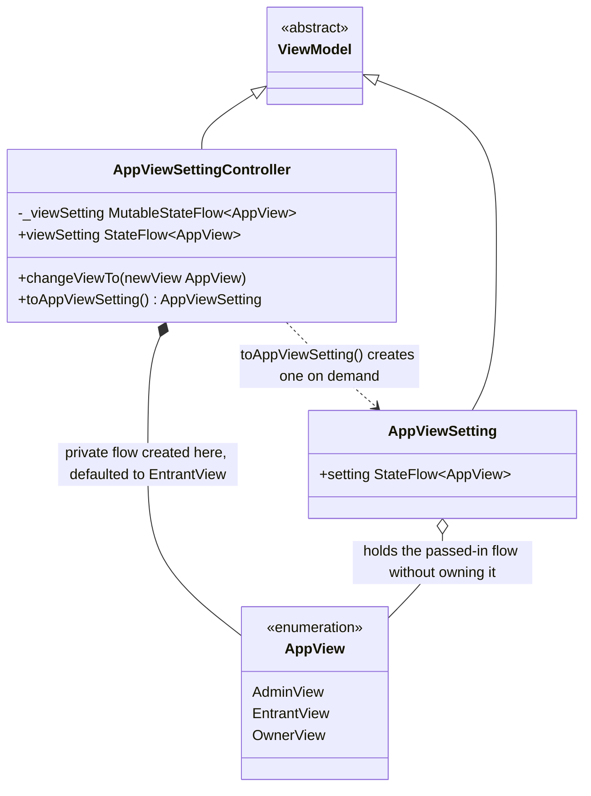
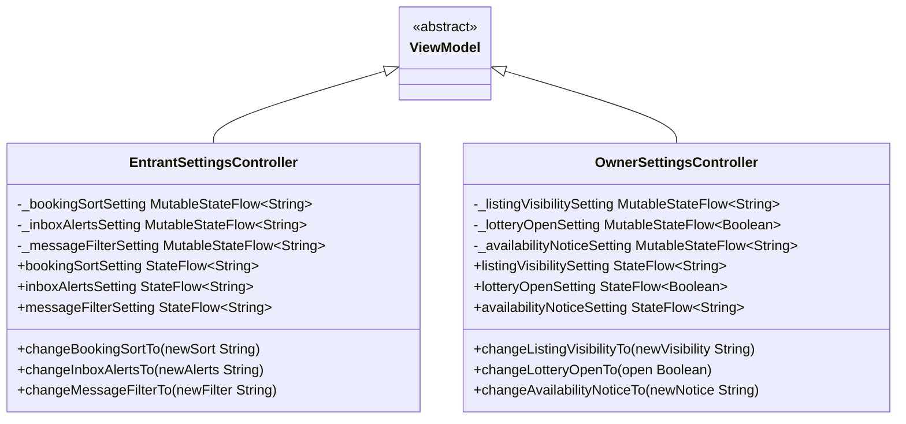

# App Settings

UML documentation for the app-wide view-setting ViewModel in
`CampBNB/app/src/main/java/com/example/campbnb/viewModels/AppViewSettings.kt`, which switches
the app between the Entrant, Campsite Owner and Admin perspectives (US 03.11.01).

Reading the diagram:

- Inheritance (solid line, hollow triangle): both classes extend `ViewModel` in
  Kotlin, which is what Jetpack Compose requires to keep the setting alive across
  re-renders.
- Composition (filled diamond, `*--`): the controller creates its own private
  `MutableStateFlow` and thus owns the setting; `changeViewTo` moves the flow it
  exposes.
- Aggregation (open diamond, `o--`): `AppViewSetting` is handed the controller's
  flow, it references it but does not own it.
- Dependency (dotted arrow): `toAppViewSetting()` produces a separate read-only
  view class on demand; superviews that latch on to the returned setting re-render
  automatically when `changeViewTo` switches the setting, because the setting holds
  the `StateFlow` handle itself, never a snapshot value.
- The default is `EntrantView` because it has the least nefarious use; `OwnerView`
  and `EntrantView` mirror those users' perspectives.

## Role settings placeholders for the Settings modal

UML documentation for the per-role settings ViewModels in
`CampBNB/app/src/main/java/com/example/campbnb/viewModels/SettingsViewModels.kt`, edited from the
Settings modal while the matching view is current (US 03.11.01, paired with the Admin settings
worked separately). The settings entries themselves are placeholders chosen from what each role's
own views can do; only the structure is settled so real entries can replace them later.

Reading the diagram:

- Inheritance (solid line, hollow triangle): both controllers extend `ViewModel` so the
  settings survive re-rendering, exactly as `AppViewSettingController` does.
- Each entry follows the established private-`MutableStateFlow` plus public-`asStateFlow`
  shape: the panels latch on to the readonly flows and re-render when a `change...` method
  moves one.
- The panel composables in `ui/settings/SettingsPanels.kt` consume these plus an
  `AppViewSetting`: while their view is current they render their entries, and otherwise one
  muted inactive line. Neither panel fills its container, so both stay stackable below the
  Admin settings section, which keeps being editable regardless.

