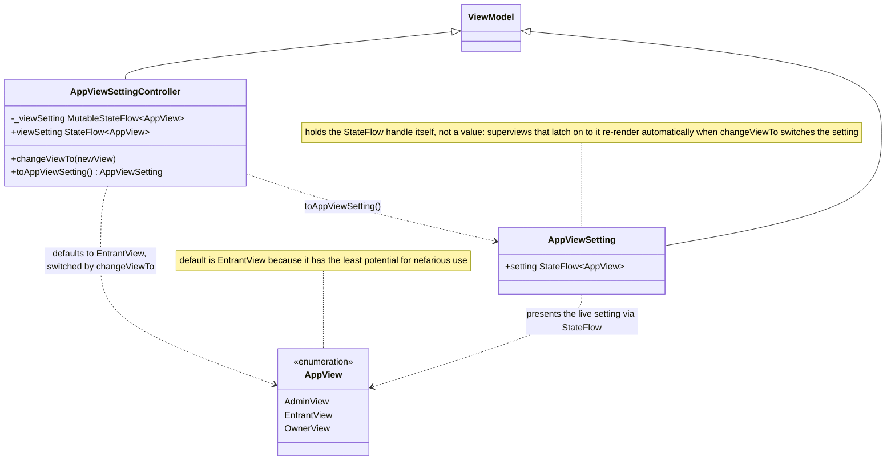

# App Settings

UML documentation for the app-wide view-setting ViewModel in
`CampBNB/app/src/main/java/com/example/campbnb/viewModels/AppViewSettings.kt`, which switches
the app between the Entrant, Campsite Owner and Admin perspectives (US 03.11.01).

