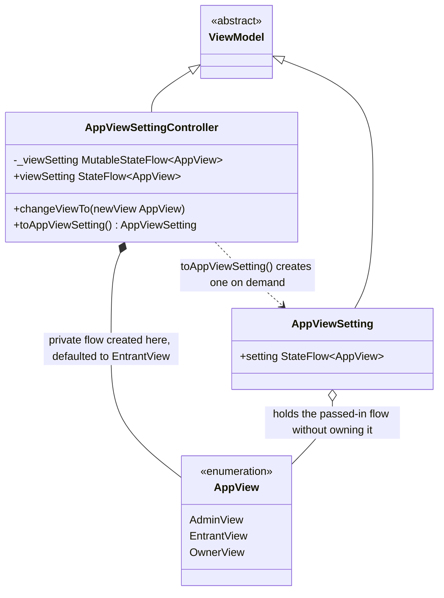
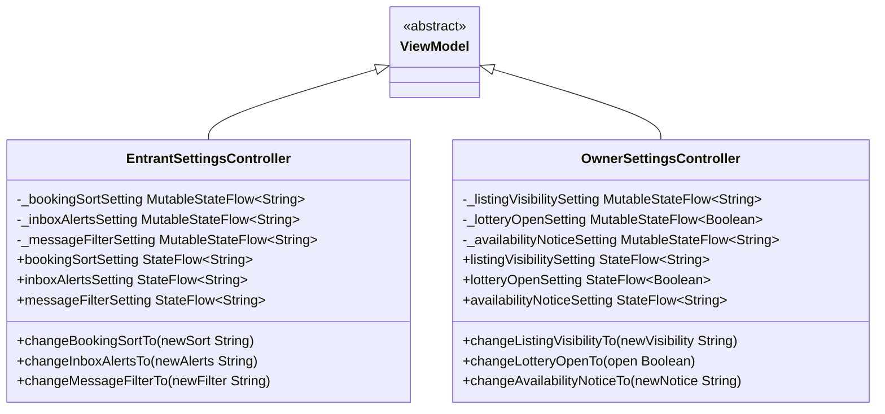

# App Settings

UML documentation for the app-wide view-setting ViewModel in
`CampBNB/app/src/main/java/com/example/campbnb/viewModels/AppViewSettings.kt`, which switches
the app between the Entrant, Campsite Owner and Admin perspectives (US 03.11.01).



Reading the diagram:

- Inheritance (solid line, hollow triangle): both classes extend `ViewModel` in
  Kotlin, which is what Jetpack Compose requires to keep the setting alive across
  re-renders.
- Composition (filled diamond, `*--`): the controller creates its own private
  `MutableStateFlow` and thus owns the setting; `changeViewTo` moves the flow it
  exposes.
- Aggregation (open diamond, `o--`): `AppViewSetting` is handed the controller's
  flow, it references it but does not own it.
- Dependency (dotted arrow): `toAppViewSetting()` produces a separate read-only
  view class on demand; superviews that latch on to the returned setting re-render
  automatically when `changeViewTo` switches the setting, because the setting holds
  the `StateFlow` handle itself, never a snapshot value.
- The default is `EntrantView` because it has the least nefarious use; `OwnerView`
  and `EntrantView` mirror those users' perspectives.

## Role settings placeholders for the Settings modal

UML documentation for the per-role settings ViewModels in
`CampBNB/app/src/main/java/com/example/campbnb/viewModels/SettingsViewModels.kt`, edited from the
Settings modal while the matching view is current (US 03.11.01, paired with the Admin settings
worked separately). The settings entries themselves are placeholders chosen from what each role's
own views can do; only the structure is settled so real entries can replace them later.



Reading the diagram:

- Inheritance (solid line, hollow triangle): both controllers extend `ViewModel` so the
  settings survive re-rendering, exactly as `AppViewSettingController` does.
- Each entry follows the established private-`MutableStateFlow` plus public-`asStateFlow`
  shape: the panels latch on to the readonly flows and re-render when a `change...` method
  moves one.
- The role-section rendering now lives in `ui/settings/SettingsScreen.kt`: the screen's
  dropdown groups consume these plus the live view setting. The standalone list-style panels
  first drafted here were superseded by that screen and removed.

## The Settings screen itself

UML documentation for the dropdown-display ViewModel and the pure ordering model in
`ui/settings/SettingsScreen.kt`: a full-screen settings body with a back button (top left,
which runs the back lambda it is handed so the user returns to the screen just on), a
Settings header (top center), and a dropdown menu below. The screen registration itself is
done separately.

```mermaid
classDiagram
    class SettingsDisplayController {
        -appViewSwitchState MutableStateFlow~Boolean~
        -adminSettingsState MutableStateFlow~Boolean~
        -entrantSettingsState MutableStateFlow~Boolean~
        -ownerSettingsState MutableStateFlow~Boolean~
        +expandedStateOf(groupId String) StateFlow~Boolean~
        +toggleGroup(groupId String)
        +pressBack()
    }

    class UserRole {
        CAMPER
        OWNER
        ADMIN
    }

    SettingsDisplayController : onBack () -> Unit (constructor-injected back lambda)

    ViewModel <|-- SettingsDisplayController
    SettingsDisplayController ..> SettingsGroupId : expansion state keyed by group name
    SettingsScreen ..> settingsGroupsFor : mounts the groups it returns, in order
    settingsGroupsFor ..> UserRole : the user's role decides which sections exist
    settingsGroupsFor ..> AppView : the current view decides which extra section appears below
    SettingsDisplayController ..> AppViewSettingController : pressBack runs the handed back lambda; the app view switch group calls changeViewTo
```

Reading the diagram:

- The `settingsGroupsFor` model is pure (role, view) -> ordered groups: an admin sees the
  app view switch first, then admin settings, and the current non-admin view's settings
  only below the admin settings; non-admin users see only their own section. The screen
  renders exactly what the model returns, so the ordering is testable without rendering.
- `SettingsDisplayController` holds one `MutableStateFlow` per known group name from
  `SettingsGroupId`; tapping a dropdown calls `toggleGroup`, and the screen re-renders
  only that group through the `expandedStateOf` readonly flow.
- The back button calls `pressBack`, which runs the constructor-injected back lambda;
  the unit tests drive all three behaviours (back goes back, a tap opens only that
  dropdown, a view switch reveals the settings in their documented place).


## Component choices for the Settings screen controls
- The house GradientButton forces full width and a 44.dp pill; for the Settings screen that fights long group labels and a compact back affordance. A clone, GradientBarButton, was added in the shared components file instead of touching the original: the caller sizes it, a second modifier styles the label, and the height is a parameter. The screen's dropdown headers and back affordance use the clone; auth screens keep using the original untouched.
- Whether material3's DropdownMenu fits a group was checked per group, not assumed:
  - App view switch: it fits. Its content is exactly selectable options with presses, and the expansion state stays owned by the SettingsDisplayController (the flow feeds the menu's expanded flag; a dismissal through the menu's own closing calls the same controller toggle, so the two can never disagree).
  - Entrant, owner, admin sections: it does not fit. Their content is live current-value rows with no selection semantics, and the admin section is an arbitrary caller composable; none of that maps onto menu items, so those groups keep the inline expanded-rows form.
- The back affordance is now the BackArrow glyph: a filled chevron band drawn house-style like the dropdown arrow with a canvas path, sitting in the clickable text area from Wyatt's settings-view fixes commit; his transparent spacer was left untouched. (This Compose's draw path form has no stroke-width knob, which is why the chevron is a filled band rather than a stroked one.) The intermediate gradient-pill treatment of back was rejected and reverted before the glyph replaced it.
