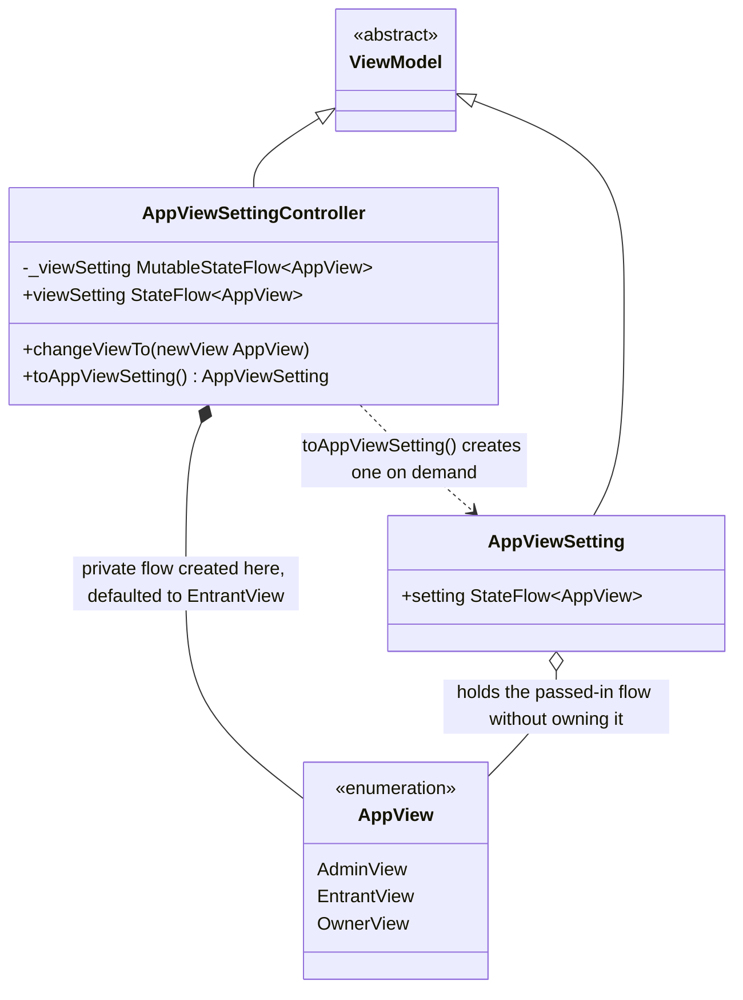

# App Settings

UML documentation for the app-wide view-setting ViewModel in
`CampBNB/app/src/main/java/com/example/campbnb/viewModels/AppViewSettings.kt`, which switches
the app between the Entrant, Campsite Owner and Admin perspectives (US 03.11.01).

Reading the diagram:

- Inheritance (solid line, hollow triangle): both classes extend `ViewModel` in
  Kotlin, which is what Jetpack Compose requires to keep the setting alive across
  re-renders.
- Composition (filled diamond, `*--`): the controller creates its own private
  `MutableStateFlow` and thus owns the setting; `changeViewTo` moves the flow it
  exposes.
- Aggregation (open diamond, `o--`): `AppViewSetting` is handed the controller's
  flow, it references it but does not own it.
- Dependency (dotted arrow): `toAppViewSetting()` produces a separate read-only
  view class on demand; superviews that latch on to the returned setting re-render
  automatically when `changeViewTo` switches the setting, because the setting holds
  the `StateFlow` handle itself, never a snapshot value.
- The default is `EntrantView` because it has the least nefarious use; `OwnerView`
  and `EntrantView` mirror those users' perspectives.
