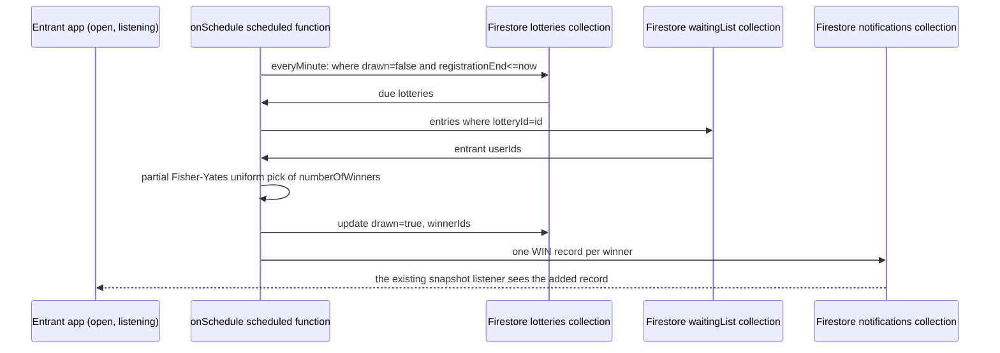

# Automatic Lottery Draws

UML documentation for the out-of-app draw of `CampBNB/functions/` (US 02.05.01): the time-scheduled function that picks winners when a registration period ends and creates notification records for them. The Kotlin side only reads the result.

## What the requirement forces

US 02.05.01 requires winners to be drawn and notified without opening the app or requiring owner action.

Since Firestore has no scheduler of its own, a scheduled Firebase Cloud Function handles the draw. This requires the Firebase Blaze plan.

Reading the diagram:

- One scheduled function handles the draw, marks the lottery as drawn, and creates notifications.
- A Firestore transaction prevents duplicate draws, and deterministic notification IDs make notification writes idempotent.
- The app reads `drawn` and `winnerIds` through `LotteryController.checkIfWon` and receives notifications through its existing snapshot listener.
- Notifications are permanent in-app records. Phone push notifications are out of scope.

## Wire contract the function must match

The function uses the same document fields defined in `models/Lottery.kt`, `models/WaitingListEntry.kt`, `models/Notification.kt`, and the collections in `database/Database.kt`.

| Document | Where written by the app | Fields the function reads/writes |
| --- | --- | --- |
| lottery | `lotteries` collection | reads `drawn`, `registrationEnd`, `numberOfWinners`; writes `drawn=true`, `winnerIds` |
| entry | `waitingList` collection | reads `lotteryId`, `userId` |
| notification | `notifications` collection, id `${lotteryId}_${userId}_WIN` | all of `Notification`'s fields; enums as their names (`WIN`, `UNREAD`), `senderId` empty for system-created |

The encoded fields match the Kotlin serialization declarations, but have not yet been verified against a live Firestore deployment.

## Deployment

`CampBNB/functions/` contains the function source. Deployment is done manually through the Firebase CLI by the Firebase project owner and requires the Blaze plan.