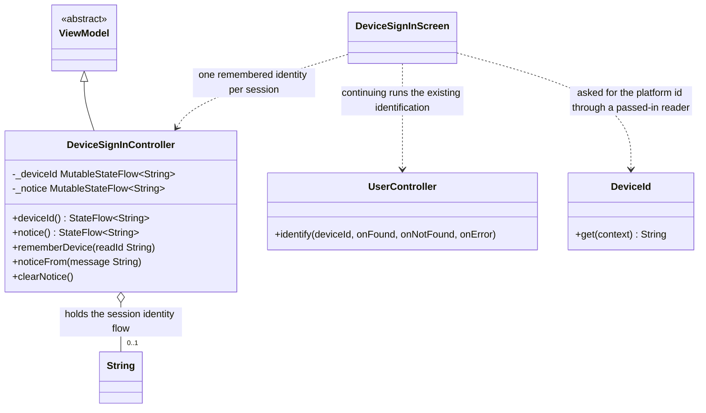

# Device Sign-On

UML documentation for the entrant sign-on identified by device, in
`CampBNB/app/src/main/java/com/example/campbnb/ui/Screens/DeviceSignInScreen.kt`
with its ViewModel in `viewModels/DeviceSignInViewModels.kt` (US 01.09.01).
The upstream identity already exists: the entity is keyed by the device id, the
control looks one up, and the shared reader hands the platform id out. What is
built here is the sign-on itself - entering through a device so the entrant never
uses a username or a password for the duration of their app use (US 01.09.01).

Reading the diagram:

- Inheritance (solid line, hollow triangle): the controller extends `ViewModel` so
  the session identity survives re-renders, as every state holder here does.
- Composition (filled diamond): the controller creates its own private
  `MutableStateFlow` for the identity and the notice; nothing hands them in.
- The screen (a `DeviceSignInScreen` composable, shown here as a dependency for
  readability) never owns data: it asks for the device through a passed-in reader
  so the screen stays I/O-free, writes the first readable value down once, and
  Continuing runs the upstream identification against that value.
- Aggregation (open diamond): the zero-or-one held string is the session identity
  itself; while it is empty nobody is signed on, and once it holds, every later
  render reuses it - the entrant types nothing at any point.

## Behaviour and choices

- First readable read wins exactly once per session: blank reads are ignored, and
  a later different read never replaces the signed-on identity (a device swap
  mid-session re-enters under the original identity; the request does not define
  live swapping - PLACEHOLDER note, kept in the test placement).
- Unreadable device: nothing is written down, and the notice flow carries the
  reason so the screen says why sign-on is unavailable instead of silently
  disabling the affordance.
- A brand-new device enters straight away; its profile details belong to the
  profile stories, not to sign-on (PLACEHOLDER note in the screen comments).
- No field ever collected here is a username or a password; the identity is the
  device id, matching the entity the upstream keyed by it.

## Test placement

`DeviceSignInTest.kt` sits at the test root and drives the ViewModel directly,
like the settings and log-display suites do: unreadable reads sign nobody on and
leave the reason visible, the first readable id is remembered and never replaced,
an unchanging re-read stays put, and notices appear and are dropped on demand.
