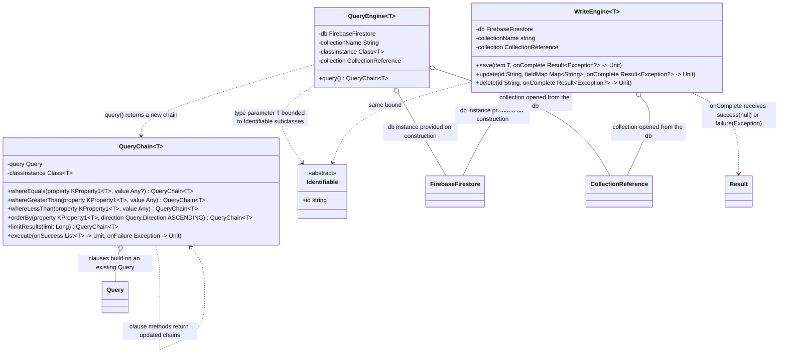

# Engines

UML documentation for `QueryEngine<T>` and `WriteEngine<T>` and their helper classes
(`CampBNB/app/src/main/java/com/example/campbnb/database/`). The `FirebaseFirestore`,
`CollectionReference`, `Query`, and `Result` classes are library types, not part of this
repository.

Reading the diagram:

- Aggregation (open diamond, `o--`): every collaborator is passed in or opened at
  construction and exists independently of the engine, so no filled composition
  markers appear here; engines hold references, they never own lifecycle.
- Dependency (dotted arrow, `..>`): `query()` produces a `QueryChain` rather than
  holding one; chained clause methods depend on further chains of the same kind;
  the `T` type parameter is constrained to subclasses of `Identifiable`.
- There are no interface implementations in the engine code, so no dotted
  interface lines appear; the notation (`<|..`) would be used if there were.
- Signatures carry the Kotlin parameter types; where the renderer cannot express a type
  (a generic containing a comma), the narrowed form is shown: `KProperty1(T, *)` appears
  as `KProperty1~T~`, which is what makes `whereEquals`/`orderBy` take typed property
  references, so the queried property is guaranteed to belong to `T`.
- `execute`'s callbacks are `(List<T>) -> Unit` and `(Exception) -> Unit`;
  `WriteEngine`'s `onComplete` is `(Result<Exception?>) -> Unit`.
- `Identifiable` is instantiated with a random UUID; Firestore repopulates `id`
  from the `DocumentId` annotation on read, which is why the class is abstract and
  never instantiated by hand.
- Engines are constructed inline via the extension functions
  `db.readEngineFor(collectionName)` and `db.writeEngineFor(collectionName)`;
  write documents are keyed on the `Identifiable` id.
