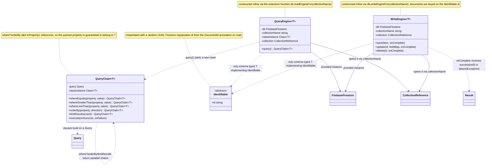

# Engines

UML documentation for `QueryEngine<T>` and `WriteEngine<T>` and their helper classes
(`CampBNB/app/src/main/java/com/example/campbnb/database/`). The `FirebaseFirestore`,
`CollectionReference`, `Query`, and `Result` classes are library types, not part of this
repository.

