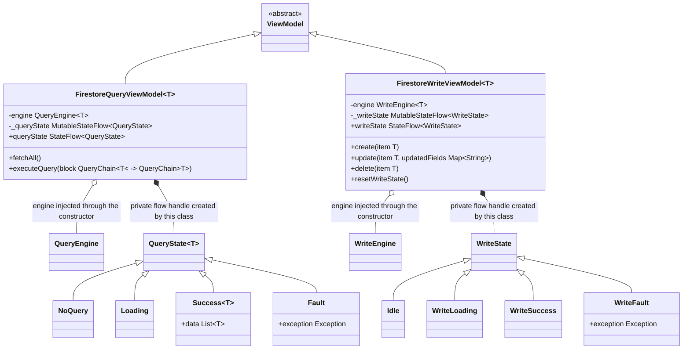

# Firestore Views

UML documentation for `FirestoreQueryViewModel<T>` and `FirestoreWriteViewModel<T>`,
the state hierarchies they expose via `StateFlow` (`QueryState`, `WriteState`), and the
engines they drive (`CampBNB/app/src/main/java/com/example/campbnb/database/`).

Reading the diagram:

- Inheritance (solid line, hollow triangle): the state subclasses and both ViewModels
  extend their bases in Kotlin. `QueryState` and `WriteState` are Kotlin `sealed`, so
  the hierarchies shown are exhaustive, no state may be added from outside. `NoQuery`
  and `Idle` mark "nothing run yet", `Loading`/`WriteLoading` mean a query or write is
  running unresolved, `Success`/`WriteSuccess` report the latest result (an empty list
  is still a success), `Fault`/`WriteFault` carry the reason the engine could not
  complete, and `resetWriteState` returns the write hierarchy to `Idle`.
- Composition (filled diamond, `*--`): the private `MutableStateFlow` handles are
  created inside the ViewModels and exist only for the view's lifecycle, so the state
  they carry is composed. The state values themselves are swapped at runtime through
  the flow.
- Aggregation (open diamond, `o--`): the engines are constructed before and outside
  the ViewModels and passed in, so they are not owned.
- `updatedFields` is `Map<String, Any?>`, shown narrowed as `Map~String~` because the
  renderer cannot express a generic containing a comma; `executeQuery`'s block is the
  Kotlin lambda-with-receiver `QueryChain<T>.() -> QueryChain<T>`.
- State must be held by a `ViewModel` or Jetpack Compose disposes of it on re-render;
  `viewModelScope.launch` disposes of running work when a view is closed. Both
  ViewModels are Kotlin `open` classes, so subviews may extend them;
  `executeQuery` accepts a `QueryChain` builder block starting at the base query, and
  `create`/`update`/`delete` mirror the `WriteEngine` operations, moving the exposed
  state through `Loading` into `Success` or `Fault`.
