# Firestore Views

UML documentation for `FirestoreQueryViewModel<T>` and `FirestoreWriteViewModel<T>`,
the state hierarchies they expose via `StateFlow` (`QueryState`, `WriteState`), and the
engines they drive (`CampBNB/app/src/main/java/com/example/campbnb/database/`).

```mermaid
classDiagram
    class ViewModel

    class QueryState~T~ <<abstract>>
    class NoQuery
    class Loading
    class Success~T~ {
        +data List~T~
    }
    class Fault {
        +exception Exception
    }

    class WriteState <<abstract>>
    class Idle
    class WriteLoading
    class WriteSuccess
    class WriteFault {
        +exception Exception
    }

    class FirestoreQueryViewModel~T~ {
        -engine QueryEngine~T~
        -_queryState MutableStateFlow~QueryState~
        +queryState StateFlow~QueryState~
        +fetchAll()
        +executeQuery(block)
    }
    class FirestoreWriteViewModel~T~ {
        -engine WriteEngine~T~
        -_writeState MutableStateFlow~WriteState~
        +writeState StateFlow~WriteState~
        +create(item)
        +update(item, updatedFields)
        +delete(item)
        +resetWriteState()
    }

    QueryState <|-- NoQuery
    QueryState <|-- Loading
    QueryState <|-- Success
    QueryState <|-- Fault
    WriteState <|-- Idle
    WriteState <|-- WriteLoading
    WriteState <|-- WriteSuccess
    WriteState <|-- WriteFault

    ViewModel <|-- FirestoreQueryViewModel
    ViewModel <|-- FirestoreWriteViewModel

    FirestoreQueryViewModel ..> QueryEngine : runs queries through the engine
    FirestoreWriteViewModel ..> WriteEngine : save/update/delete through the engine
    FirestoreQueryViewModel ..> QueryState : exposes current via StateFlow
    FirestoreWriteViewModel ..> WriteState : exposes current via StateFlow

    note for QueryState "sealed in Kotlin: the states shown are exhaustive, none may be added from outside. NoQuery no query run yet; Loading a query running, unresolved; Success carries the entries read, not necessarily any; Fault the reason the engine could not complete"
    note for WriteState "sealed in Kotlin, same rules: Idle no writes active; WriteLoading running, unresolved; WriteSuccess latest writes executed; WriteFault the reason one could not complete. resetWriteState returns the hierarchy to Idle"
    note for ViewModel "state must be held by a ViewModel or Jetpack Compose disposes of it on re-render; viewModelScope.launch disposes of running work when a view is closed"
```

