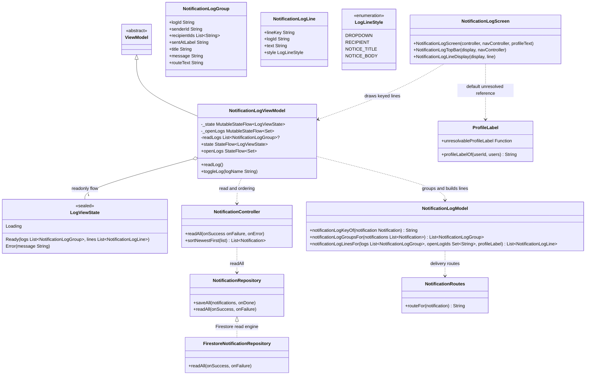

# Notification Logs

UML documentation for the notification debug log in
`CampBNB/app/src/main/java/com/example/campbnb/ui/notification/NotificationLogScreen.kt`,
with its view state in `viewModels/NotificationLogViewModels.kt` and grouping model in
`models/NotificationLogModel.kt` (US 03.08.01).

The log uses the existing notification repository, controller and delivery routes.

Reading the diagram:

The screen displays the current `LogViewState`. The view model retrieves saved
notifications through the controller, orders them newest first, and uses the
grouping model to build a list of log entries. Each entry can be expanded to
display its recipients, title and message. The refresh button reads the
notifications again.

## Design Choices

- **One-shot read:** Notifications are loaded when the log opens or the
  refresh button is pressed, rather than through a continuous listener.

- **Grouping key:** Records belonging to the same broadcast are grouped
  into one log entry.

- **One entry per message:** Each message notification has its own log
  entry rather than grouping an entire conversation.

- **Timestamp:** `describeSavedAt` formats the saved timestamp when the
  log is built.

- **Flat list:** `NotificationLogLine` stores the text, style and stable
  key of each displayed line.

- **Profile labels:** Recipient labels are resolved when the lines are
  built, rather than during screen rendering.

- **Ordering:** `NotificationController.sortNewestFirst` determines the
  order of notifications.

- **State management:** `NotificationLogViewModel` extends `ViewModel`
  and manages the screen state.

- **Open dropdowns:** A `StateFlow<Set<String>>` stores the keys of
  expanded log entries.

The screen receives the shared notification controller, navigation
controller and profile resolver from the app.

## Testing

Tests are located in `notificationTests/NotificationLogTest.kt` and use
`FakeNotificationRepository`.

They cover notification grouping, ordering, dropdown behaviour, empty
logs, missing timestamps, unresolved profiles, repeated refreshes and
failed reads.