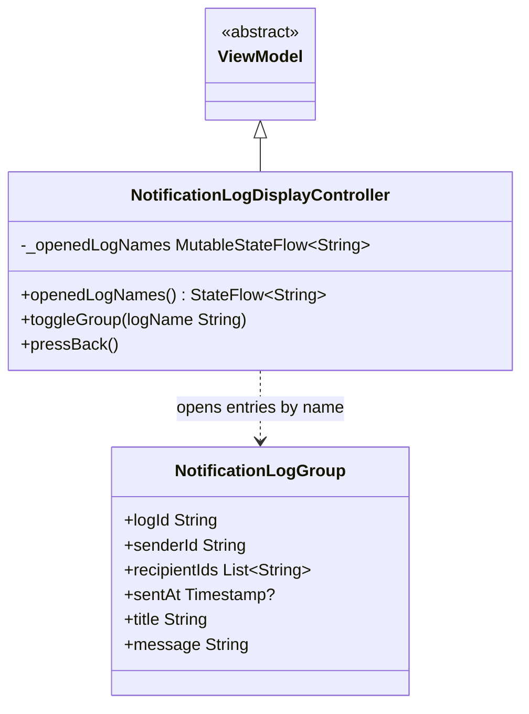

# Notification Logs

UML documentation for the ViewModel and pure model of the notification
debugging screen in `CampBNB/app/src/main/java/com/example/campbnb/ui/notification/NotificationLogScreen.kt`
and its ViewModel in `viewModels/NotificationLogViewModels.kt`, which shows saved
notification records joined into one entry per broadcast, each as a dropdown
(US 03.08.01). The screen is a debugging tool: it is not registered as a
destination of the app, it is opened through its back lambda from wherever it
gets wired.

Reading the diagram:

- Inheritance (solid line, hollow triangle): the controller extends `ViewModel` so
  the open-dropdown state survives re-renders, same as the settings display
  controller.
- Open dropdowns are kept as one immutable `MutableStateFlow<String>` of the open
  log names, newline-delimited, instead of one flow per group: log entries are not
  a known fixed set like the settings groups, one exists per broadcast at runtime,
  so their names come from the data. A tap adds or removes its `\nname\n` marker;
  a name containing a newline could match falsely, but the names the model
  produces are joined without newlines (PLACEHOLDER note, kept in the code).
- `pressBack()` runs the back lambda the screen was handed at construction, so
  leaving this screen returns to the screen just on.
- `NotificationLogGroup` is a plain view data class, not an `Identifiable`:
  nothing in this area is written to the database, the entries only read the
  saved records.

## The grouping model

Pure functions over the saved records, in `NotificationLogScreen.kt`:
`logKeyOf`, `notificationLogGroupsFor`, `latestSentAtOf`, `summaryLine`,
`notificationLogProfileAt`, `describeTimestamp`.

- An entry's stable name is the join of the seven record fields that describe the
  broadcast itself - `senderId`, `type`, `title`, `message`, `lotteryId`,
  `reservationId`, `campsiteName` - joined with a separator character records
  never contain, and leaving the per-receiver fields out. Records that merely
  happen to share all seven fields would merge into one entry too; the app does
  not yet write a shared event id into the notification records, so this is as
  close as the data gets (PLACEHOLDER note, kept in the code).
- Entries order newest-first mirroring how the inbox sorts its own list; a record
  whose server timestamp was never saved sorts to the top.
- Receivers of one broadcast are collected in save order without repeats, and the
  entry carries the latest timestamp its records hold, since each record carries
  its own.
- The collapsed dropdown line shows, in order: who sent it (or the system when no
  sender), how many receivers, and the saved time as a date-and-time label
  rendered with the same calendar-and-pattern pair the date utilities use, or a
  note when no timestamp was saved.

## Wire note over Notification

The record fields above mirror `models/Notification.kt`: the grouped seven are
exactly the fields that describe the broadcast, `recipientId` is the excluded
per-receiver field collected into the entry's list, and `status`, `pushAllowed`
and `readAt` are irrelevant here - this screen reads the archive of saves, not
inbox state. Profile rows go through a `profileText` lambda the caller supplies
over the receiver id the model hands back by index; real profile fields exist
on the user model now, so the wiring can be replaced with real profile text at
call time (PLACEHOLDER at caller wiring).

## The dropdown rendering

The first level is one clickable dropdown bar per entry: the bar shows the
summary line and a chevron, and tapping toggles the controller's marker for that
entry. Inside, the second level is the profile rows: this toolchain has no
virtualized list, so the rows are drawn one per model index under a scroll -
laziness lives at the data level (`notificationLogProfileAt` answers by index,
out-of-range answers empty), and the viewport scrolls. The row text is whatever
the caller's `profileText` produces.

## Test placement

The suite sits in the `notificationTests` package beside the notification
controller and channels tests, matching where the notification area's tests were
moved upstream.
