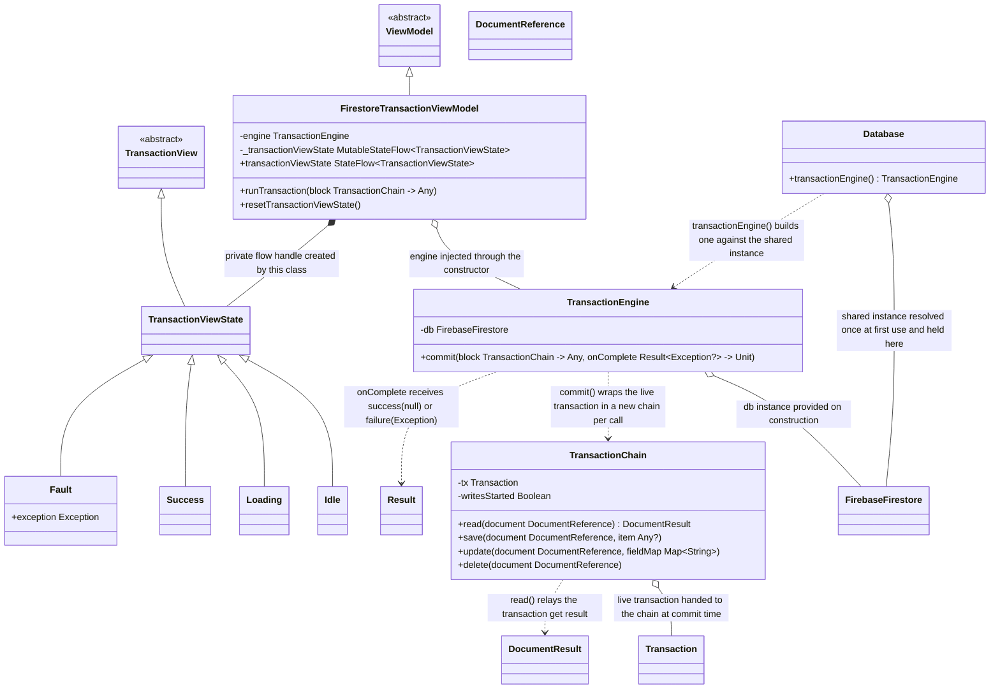

# Transactions

UML documentation for `TransactionEngine` and its helper class `TransactionChain`, the
view contract `TransactionView` and its sealed implementation `TransactionViewState`, and
the `FirestoreTransactionViewModel` that exposes them
(`CampBNB/app/src/main/java/com/example/campbnb/database/`). `Database`, also in that
directory, hands out the engine against its shared Firestore instance. The `FirebaseFirestore`,
`Transaction`, `DocumentReference`, `DocumentResult`, and `Result` classes are library
types, not part of this repository.

Reading the diagram:

- Inheritance (solid line, hollow triangle): the state subclasses extend their base in Kotlin.
  `TransactionViewState` is Kotlin `sealed` and extends the `TransactionView` base, so the
  hierarchy shown is exhaustive and no state may be added from outside; the base is kept so
  that other ViewModels may latch on to the view contract rather than to one implementation.
  `Idle` marks "no transaction run yet", `Loading` means a transaction is running unresolved
  (Firestore may retry internally on conflicts; the view stays `Loading` until the
  transaction commits or fails), `Success` reports the latest committed transaction, `Fault`
  carries the reason the engine could not complete it, and `resetTransactionViewState`
  returns the hierarchy to `Idle`.
- Composition (filled diamond, `*--`): the private `MutableStateFlow` handle is created inside
  the ViewModel and exists only for the view's lifecycle; state values are swapped at runtime
  through the flow.
- Aggregation (open diamond, `o--`): the engines are constructed before and outside the
  ViewModels and passed in, so they are not owned; the live Firestore `Transaction` is
  provided by the engine at commit time and exists independently of the chain; `Database`
  resolves the Firestore instance once at first use and holds the same shared instance
  every engine it hands out is built against.
- Dependency (dotted arrow, `..>`): `commit()` produces a `TransactionChain` rather than
  holding one, wrapping the live transaction for the duration of the call; `read()` relays
  the engine's get result; `onComplete` receives `success(null)` or `failure(Exception)`,
  the same result contract as the other engines.
- `commit`'s block is the Kotlin lambda-with-receiver `TransactionChain.() -> Any`, so
  `read`, `save`, `update`, and `delete` resolve against the chain inside the block. Between
  those calls the block is ordinary Kotlin: read results may be converted and tested against,
  local values may hold them, and later writes may be derived from what was read, so a
  repository's own transaction bodies (a conditional close that reads a reservation, checks
  its status, updates it, and deletes its booked dates) convert unchanged.
- Unlike the other engines, this engine carries no `T` type parameter: a transaction spans
  however many collections it needs to hold its invariants, so it operates on
  `DocumentReference`s rather than on one schema.
- The read-before-write rule is enforced in `TransactionChain.read` rather than left to the
  engine: a read issued after a write fails at the point of the mistake, before the read
  itself happens, so a misordered transaction does no partial work past the mistake and the
  exception surfaces through `onComplete` as a `Result.failure` and through the view as
  `Fault`.
- Engines are constructed inline via the extension function `db.transactionEngine()`, or
  obtained from `Database.transactionEngine()`, which builds one against the single cached
  Firestore instance rather than a fresh one per call; application code prefers the
  `Database` accessor. Both ViewModels are Kotlin `open` classes, so subviews may extend
  them and observe `transactionViewState` through the exposed `StateFlow`.
