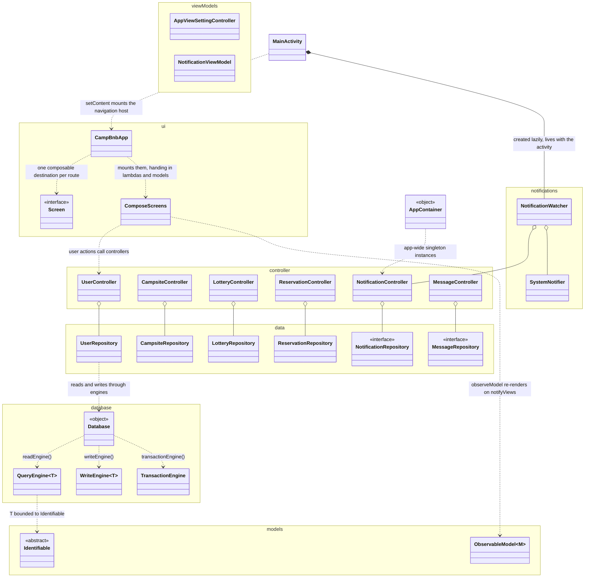
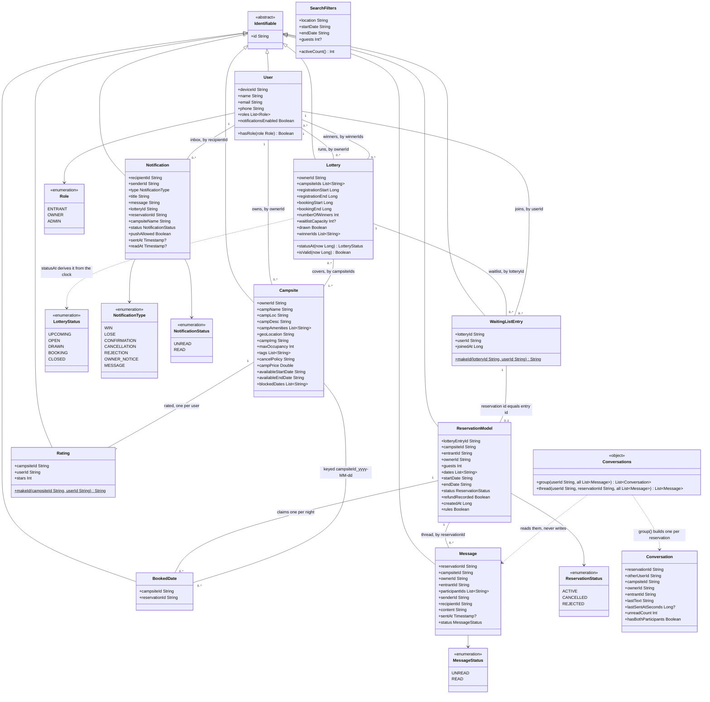
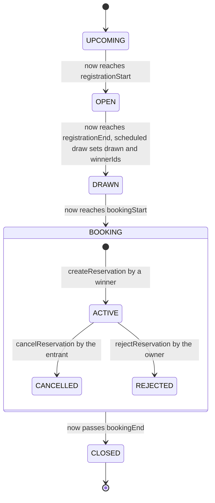
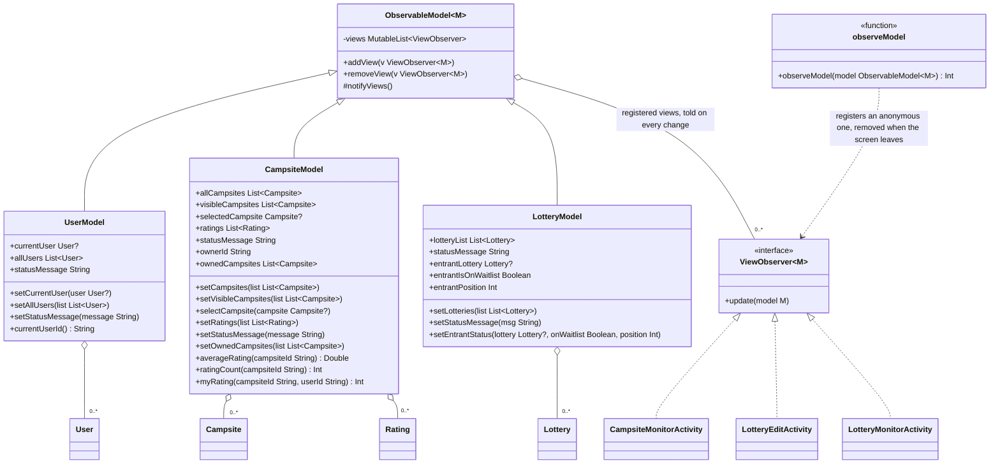
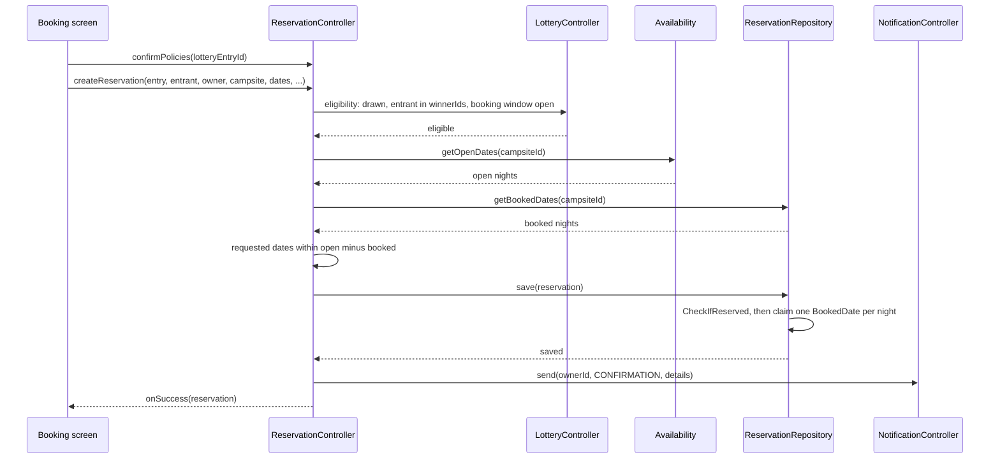
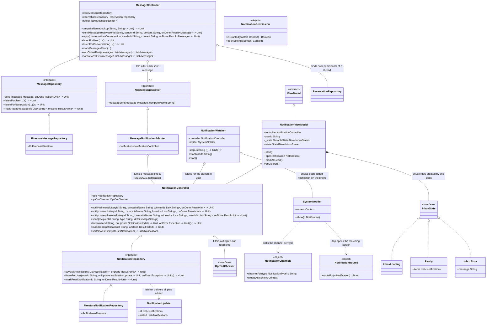
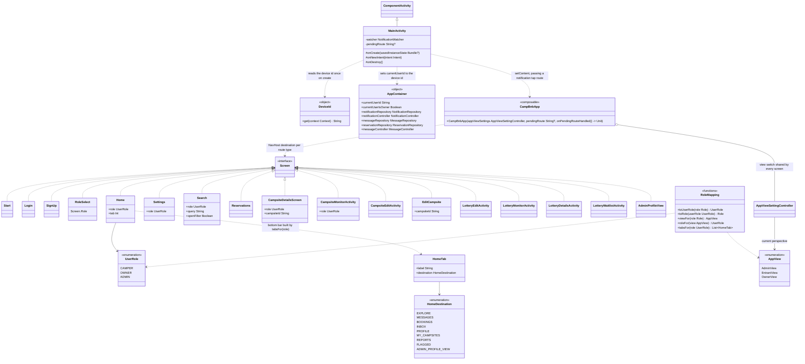

# Application

UML documentation for the whole CampBNB application
(`CampBNB/app/src/main/java/com/example/campbnb/`): the layers it is split into, the
domain entities stored in Firestore, the observable models, the controllers and
repositories that hold the business rules, the notification and messaging subsystem,
and the navigation and wiring that tie it together. The generic database layer is
documented in detail in Engines, FirestoreViews and Transactions; here it appears only
as far as the rest of the app touches it. `ViewModel`, `ComponentActivity`,
`FirebaseFirestore`, `Timestamp`, `Context` and `Result` are library types, not part of
this repository.

## Layers

Reading the diagram:

- Namespaces are the source packages. The app is MVC wired by hand, with no DI framework:
  `ui` draws and forwards user actions, `controller` decides what is allowed, `models`
  holds what is shown, `data` knows how each schema is stored, and `database` is the
  only code that talks to Firestore.
- Only one representative edge per layer is drawn (e.g. `ComposeScreens ..> UserController`,
  `UserRepository ..> Database`); every controller and every repository follows the same
  edge, as the later sections show in full.
- Aggregation (open diamond, `o--`): every controller receives its repository and its
  model through the constructor, so it references them without owning them; the
  same holds for the watcher's collaborators.
- Composition (filled diamond, `*--`): `MainActivity` creates its `NotificationWatcher`
  in a lazy field, starts it in `onCreate` and stops it in `onDestroy`, so the watcher
  lives exactly as long as the activity.
- `ComposeScreens` stands for the Compose screen functions as a group (they are named
  `*Activity.kt` but are composables; `MainActivity` is the only real Android Activity).
- `AppContainer` is the app-wide `object` that hands out the shared notification,
  message and reservation instances that must be the same for the whole process.

## Domain entities

The Firestore schemas in `models/`, every one an `Identifiable` subclass registered with
`Database`, plus the plain value classes and enums they use.

Reading the diagram:

- Inheritance (solid line, hollow triangle): every stored schema extends `Identifiable`,
  whose `id` starts as a random UUID and is overwritten from the `DocumentId` on read.
  Several schemas pin the id instead: `User` uses its `deviceId`, `WaitingListEntry`
  and `Rating` use `parent_userId` from their static `makeId`, a reservation uses its
  lottery entry id, and a `BookedDate` is keyed `campsiteId_yyyy-MM-dd`. Deterministic
  ids are what make "one entry per user per lottery", "one rating per user per
  campsite", "one reservation per entry" and "no night booked twice" hold in storage.
- Association (plain line with multiplicities): Firestore has no foreign keys, so every
  association is an id field on one side, named in the label. The labels read from the
  left class to the right one.
- Directed association (solid arrow, `-->`): the enum a field is typed with.
- Dependency (dotted arrow, `..>`): `statusAt` computes a `LotteryStatus` from the four
  timestamps rather than storing it (see Lottery and reservation lifecycles below);
  `Conversations` is a pure grouping object over messages, so a `Conversation` is
  derived on demand and never stored.
- Dates inside documents are ISO `yyyy-MM-dd` strings so Firestore range queries work
  as text comparisons; lottery windows are epoch-millisecond `Long`s.
- `SearchFilters` and `Conversation` are plain data classes, not `Identifiable`: nothing
  about them is written to the database.

## Lottery and reservation lifecycles

Reading the diagram:

- The outer states are `LotteryStatus` as `Lottery.statusAt(now)` derives it; no state
  is stored, the four timestamps decide it. `isValid` refuses any lottery whose windows
  would not run in this order (registration ends in the future, booking starts after
  registration ends, booking ends after it starts), with at least one winner and a
  waitlist capacity, if set, not below the winner count.
- Joining and leaving the waitlist (`LotteryController.join` / `leave`) is only allowed
  in `OPEN`. The `OPEN` to `DRAWN` edge is where the out-of-app scheduled function picks
  winners (documented in AutomaticDraws).
- The nested states are `ReservationStatus`. Cancelling and rejecting both free the
  reservation's booked dates; cancelling also records the refund.

## Observable models

The hand-rolled observer pattern in `models/` and the Compose bridge in
`ui/shared/ObserveModel.kt`.

Reading the diagram:

- Inheritance (solid line, hollow triangle): each `*Model` extends `ObservableModel` with
  itself as `M`. Realization (dotted line, hollow triangle, `<|..`): the screen classes
  implement `ViewObserver`.
- Every setter on `UserModel` and `CampsiteModel` assigns and then calls the protected
  `notifyViews()`, so every registered `update(model)` runs. Their public properties
  have private setters: only a controller, through the setters, moves them.
- `LotteryModel` is the exception: it keeps its values in Compose `mutableStateOf`
  holders and does not call `notifyViews()`, so Compose re-renders directly from the
  state reads and the `ViewObserver.update` of the lottery screens is never triggered.
- `observeModel` is the Compose bridge: called once at the top of a screen, it registers
  an anonymous `ViewObserver` that bumps a counter on each change (forcing a re-render)
  and removes it when the screen leaves composition.
- Aggregation (open diamond): models hold lists of entities the controllers loaded;
  the entities exist in Firestore independently of any model.

## Controllers and repositories

The business rules in `controller/` and the storage rules in `data/`.

```mermaid
classDiagram
    class UserController {
        -model UserModel
        -repo UserRepository
        +identify(deviceId String, onFound User -> Unit, onNotFound () -> Unit, onError String -> Unit)
        +register(deviceId String, name String, email String, phone String, onDone Boolean -> Unit)
        +chooseRole(role Role, onDone Boolean -> Unit)
        +updateProfile(name String, email String, phone String, onDone Boolean -> Unit)
        +setNotificationsEnabled(enabled Boolean, onDone Boolean -> Unit)
        +deleteProfile(onDone Boolean -> Unit)
        +loadAllUsers()
        +filterAllowed(userIds List~String~, onResult List~String~ -> Unit)
        +validateProfile(name String, email String) String?
    }
    class OptOutChecker {
        <<interface>>
        +filterAllowed(userIds List~String~, onResult List~String~ -> Unit)
        +AllowAll$ OptOutChecker
    }
    class CampsiteController {
        -model CampsiteModel
        -repo CampsiteRepository
        +loadAll()
        +loadRatings()
        +search(query String, filters SearchFilters)
        +search(query String, guests Int?)
        +loadAndSearch(query String, filters SearchFilters)
        +selectCampsite(campsiteId String)
        +saveRating(campsiteId String, userId String, stars Int)
        +registerCampsite(...)
        +updateCampsite(...)
        +loadAndSelect(campsiteId String)
        +loadOwnerCampsites(ownerId String)
    }
    class LotteryController {
        -model LotteryModel
        -repo LotteryRepository
        -lotteries QueryEngine~Lottery~
        -clock () -> Long
        +checkIfWon(...)
        +isBookingOpen(...)
        +loadEntrantStatus(campsiteId String, userId String)
        +findOpenLottery(allLotteries List~Lottery~, campsiteId String) Lottery?
        +join(lottery Lottery, userId String)
        +leave(lottery Lottery, userId String)
        +toggleEntrantMembership(userId String)
        +saveLottery(lottery Lottery, onSuccess () -> Unit, onFailure Exception -> Unit)
        +loadOwnerCampsites(ownerId String, onResult List~Campsite~ -> Unit)
        +loadOwnerLotteries(ownerId String)
        +loadWaitlistEntries(lotteryId String, onResult List~WaitingListEntry~ -> Unit)
    }
    class ReservationController {
        -lotteryController LotteryController
        -availability Availability
        -reservations ReservationRepository
        -notifications NotificationController
        -policiesConfirmed MutableSet~String~
        +getAvailableDates(lotteryEntryId String, entrantId String, campsiteId String, onSuccess Set~String~ -> Unit, onFailure Exception -> Unit)
        +confirmPolicies(lotteryEntryId String)
        +createReservation(lotteryEntryId String, entrantId String, ownerId String, campsiteId String, dates Set~String~, ...)
        +cancelReservation(reservationId String, requesterId String, onSuccess () -> Unit, onFailure Exception -> Unit)
        +rejectReservation(reservationId String, requesterId String, onSuccess () -> Unit, onFailure Exception -> Unit)
        +listReservations(...)
        +sendNotification(recipientId String, type String, reservation ReservationModel)
        +generateReceiptCsv(reservation ReservationModel) String
    }
    class ReservationFilter {
        <<enumeration>>
        ACTIVE
        PAST
        CANCELLED
    }
    class Availability {
        -campsites QueryEngine~Campsite~
        +getOpenDates(campsiteId String, onSuccess Set~String~ -> Unit, onFailure Exception -> Unit)
    }

    class UserRepository {
        +findByDeviceId(deviceId String, onSuccess User? -> Unit, onFailure Exception -> Unit)
        +save(user User, onComplete Result~Exception?~ -> Unit)
        +delete(userId String, onComplete Result~Exception?~ -> Unit)
        +getAll(onSuccess List~User~ -> Unit, onFailure Exception -> Unit)
        +getOptedOut(onSuccess List~User~ -> Unit, onFailure Exception -> Unit)
    }
    class CampsiteRepository {
        +SaveCampsite(campsite Campsite, onComplete Result~Exception?~ -> Unit)
        +deleteCampsite(...)
        +getAll(onSuccess List~Campsite~ -> Unit, onFailure Exception -> Unit)
        +getByOwner(ownerId String, onSuccess List~Campsite~ -> Unit, onFailure Exception -> Unit)
        +getAllRatings(onSuccess List~Rating~ -> Unit, onFailure Exception -> Unit)
        +saveRating(rating Rating, onComplete Result~Exception?~ -> Unit)
    }
    class LotteryRepository {
        +loadCampsitesByOwner(...)
        +save(lottery Lottery, onSuccess () -> Unit, onFailure Exception -> Unit)
        +getAllLotteries(onSuccess List~Lottery~ -> Unit, onFailure Exception -> Unit)
        +getLotteriesForOwner(ownerId String, ...)
        +getEntries(...)
        +addEntry(entry WaitingListEntry, onComplete Result~Exception?~ -> Unit)
        +removeEntry(...)
    }
    class ReservationRepository {
        -engine QueryEngine~ReservationModel~
        -reservationWriter WriteEngine~ReservationModel~
        -bookedDateWriter WriteEngine~BookedDate~
        +getActive(...)
        +getPast(...)
        +getCancelled(...)
        +getForOwner(...)
        +getForEntrant(...)
        +getByLotteryEntry(...)
        +getBookedDates(campsiteId String, ...)
        +CheckIfReserved(lotteryEntryId String, ...)
        +save(reservation ReservationModel, onSuccess () -> Unit, onFailure Exception -> Unit)
        +markCancelled(reservationId String, onSuccess () -> Unit, onFailure Exception -> Unit)
        +markRejected(reservationId String, onSuccess () -> Unit, onFailure Exception -> Unit)
    }
    class Database {
        <<object>>
        +Users
        +Campsites
        +Ratings
        +Lotteries
        +WaitingListEntries
        +Reservations
        +BookedDates
        +Notifications
        +Messages
        +transactionEngine() TransactionEngine
    }
    class UserModel
    class CampsiteModel
    class LotteryModel
    class NotificationController

    OptOutChecker <|.. UserController
    UserController o-- UserModel
    UserController o-- UserRepository
    CampsiteController o-- CampsiteModel
    CampsiteController o-- CampsiteRepository
    LotteryController o-- LotteryModel
    LotteryController o-- LotteryRepository
    ReservationController o-- LotteryController : checks the entrant won before booking
    ReservationController o-- Availability : open dates of the campsite
    ReservationController o-- ReservationRepository
    ReservationController o-- NotificationController : tells the other party
    ReservationController ..> ReservationFilter : listReservations slices by it
    UserRepository ..> Database : Users
    CampsiteRepository ..> Database : Campsites and Ratings
    LotteryRepository ..> Database : Lotteries, WaitingListEntries, Campsites
    Availability ..> Database : Campsites read engine
    ReservationRepository ..> Database : Reservations and BookedDates engines
```

Reading the diagram:

- Aggregation (open diamond): every collaborator is constructed outside and passed in;
  `LotteryController` additionally takes its `clock` as a constructor lambda (default
  `System::currentTimeMillis`) so the time-window rules are testable.
- Realization (dotted line, hollow triangle): `UserController` implements the
  `OptOutChecker` functional interface that `NotificationController` uses to drop
  users who switched notifications off; `OptOutChecker.AllowAll` is the default.
- Dependency (dotted arrow): repositories never hold a Firestore handle; each call opens
  the engine it needs from the named `Database` collection object (labels list which).
  `ReservationRepository` is the one repository whose engines are injected instead,
  which is why its fields are shown.
- Members ending `(...)` take the usual pair of `onSuccess` / `onFailure` callbacks after
  the listed parameters; they are elided only to keep the diagram readable.
- `getAvailableDates` is the composition of three answers: the lottery says the entrant
  won and booking is open, `Availability` gives the campsite's open nights (its
  availability window from today on, minus its blocked dates), and the repository's booked nights are subtracted.
  `createReservation` refuses to run before `confirmPolicies` was called for the entry,
  re-checks the dates are still free, then `save` claims one `BookedDate` per night
  and gives them back if the reservation write fails.

## Booking a won campsite

Reading the diagram:

- Any failing step calls `onFailure` and stops there: an unconfirmed policy, an empty
  selection, an ineligible entrant, a night taken since the list was shown, or an
  entry that already has a reservation.
- Double booking is prevented by storage, not by the check alone: the `BookedDate` ids
  are deterministic and Firestore security rules forbid overwriting one, so two
  entrants racing for the same night cannot both claim it.

## Notifications and messaging

The `notifications/` package, the inbox and message controllers, and their Firestore
repositories.

Reading the diagram:

- Realization (dotted line, hollow triangle): `NotificationRepository` and
  `MessageRepository` are interfaces with one Firestore implementation each, so unit
  tests substitute fakes; `MessageNotificationAdapter` implements `NewMessageNotifier`
  so the message controller never depends on the notification controller directly.
- `InboxState` is a Kotlin `sealed interface`; its `Loading` and `Error` members are
  shown as `InboxLoading` and `InboxError` only so their names do not collide with the
  other state hierarchies in this file.
- Both listeners return a `() -> Unit` that stops them. `NotificationWatcher` holds
  that handle between `start` and `stop`, and `NotificationViewModel` releases its own
  in `onCleared`, so no Firestore listener outlives its screen or activity.
- Aggregation (open diamond): `AppContainer` builds one `NotificationController` (with a
  `UserController` as its `OptOutChecker`) and one `MessageController` per process, and
  hands the same instances to the watcher, the inbox and the message screens.
- Composition (filled diamond): the view model owns its private state flow, which
  exists only for the screen's lifecycle.
- `Notification` is the permanent in-app record; `SystemNotifier` additionally shows a
  phone banner while the app process is alive. `NotificationPermission` lets the
  profile screen detect and fix a denied system permission.

## Navigation and wiring

The entry point, the typed routes in `Screen.kt`, and the role and view switching that
decides what each user sees.

Reading the diagram:

- Realization (dotted line, hollow triangle): every route is a member of the `sealed
  interface Screen`, a Kotlin `data object` when it carries nothing and a `data class`
  when it carries arguments, so navigation is type-checked. `RoleSelect` is shown under
  that name only to avoid a clash with the `Role` enum; in code it is `Screen.Role`.
- The sign-on flow runs `Start` to `Login` (device sign-in, which calls
  `UserController.identify`): a known device lands on `Home` with the user's first
  stored role; an unknown one goes to `SignUp` then `RoleSelect`, which also moves the
  `AppView` to match, and lands on `Home(role)`. `SignUp` currently saves the new
  `User` straight through `Database.Users` (with `Role.ADMIN`) rather than through
  `UserController.register`.
- `Home` mounts its bottom bar from `tabsFor(role)`: every role gets Explore and
  Messages; campers add Bookings, Inbox and Profile, owners add My Campsites, Inbox and
  Profile, admins add Reports, Flagged and Profiles.
- Two role vocabularies exist: `Role` is what is stored on `User`, `UserRole` is what
  the UI shows, and `AppView` is the perspective an admin can switch to. `RoleMapping`
  is the single place they are converted.
- `CampBnbApp` builds most controllers and models inside each destination with
  `remember`, so their lifetime is the destination's; only the shared instances come
  from `AppContainer`.
- Dependency (dotted arrow) from `MainActivity`: a tapped notification banner arrives
  through `onNewIntent`, is turned into `pendingRoute`, handed to `CampBnbApp` to
  navigate, and marked read.

## Placeholders not yet built

These classes exist in the source as empty shells reserved for later stories, so they
carry no members and no relationships yet: `AdminController`, `ImageRepository`,
`Image`, `Location`, `QRCode`, `NotificationModel`, `AdminActivity`, `BookingActivity`,
`PolicyActivity`, `ProfileActivity`, `UserReservationActivity`,
`OwnerReservationActivity`, `CampsiteDetailsActivity` and `CampsiteSearchActivity`.
`Reservation` is an empty shell marked for deletion: `ReservationModel` is the
reservation schema. `Database.YourSchemaPluralized` is the template object showing how
to register a new collection.
