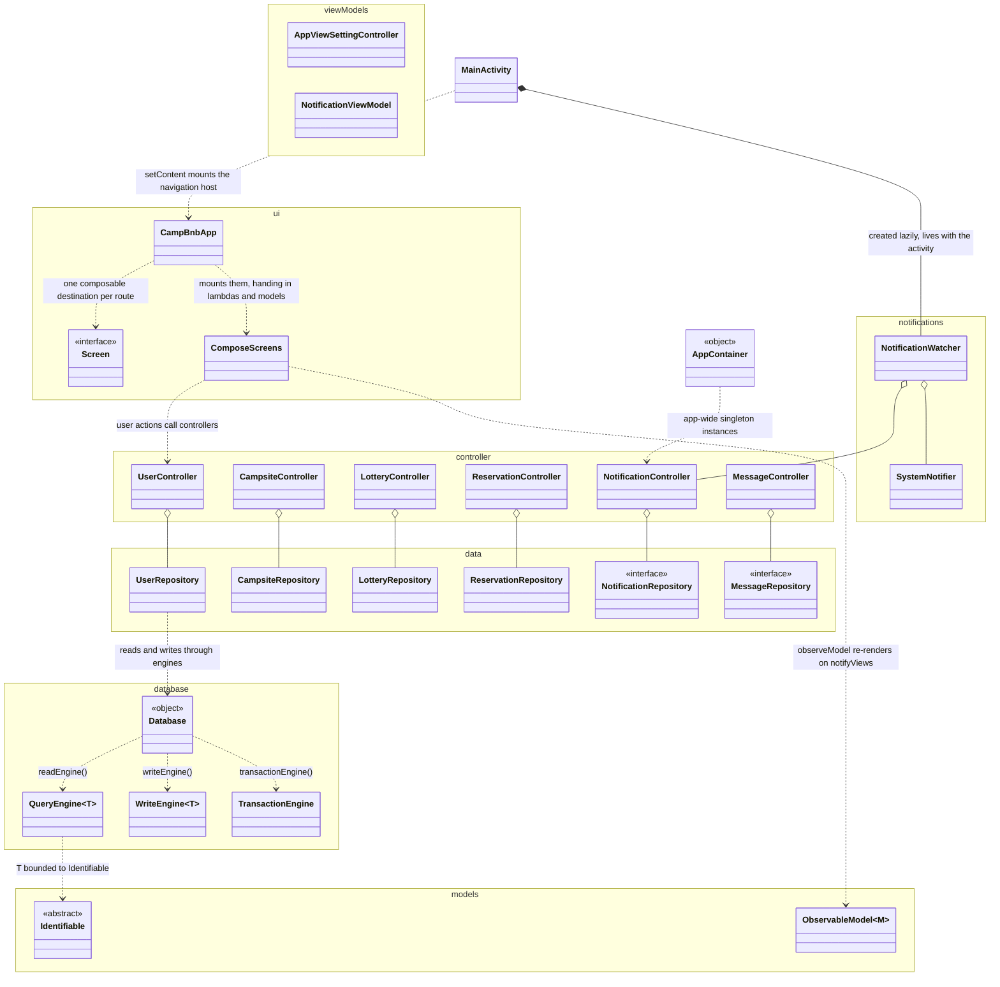
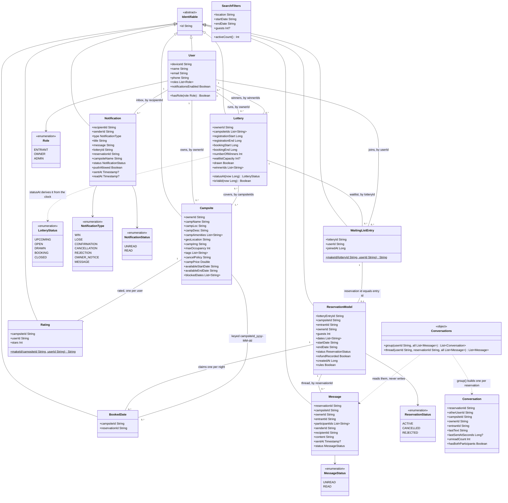
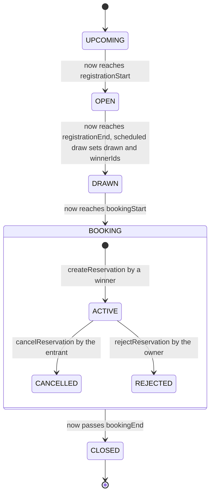
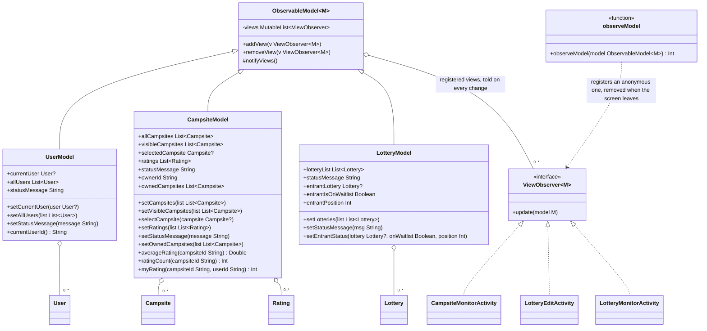
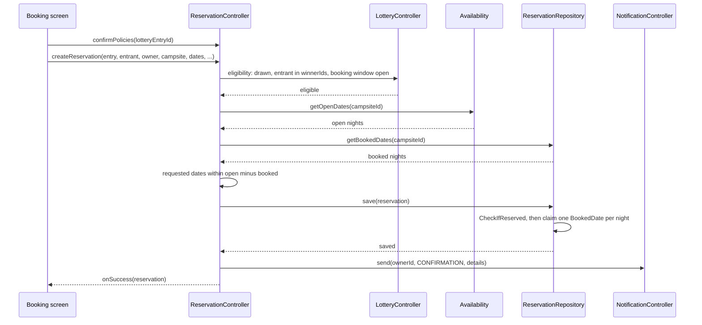
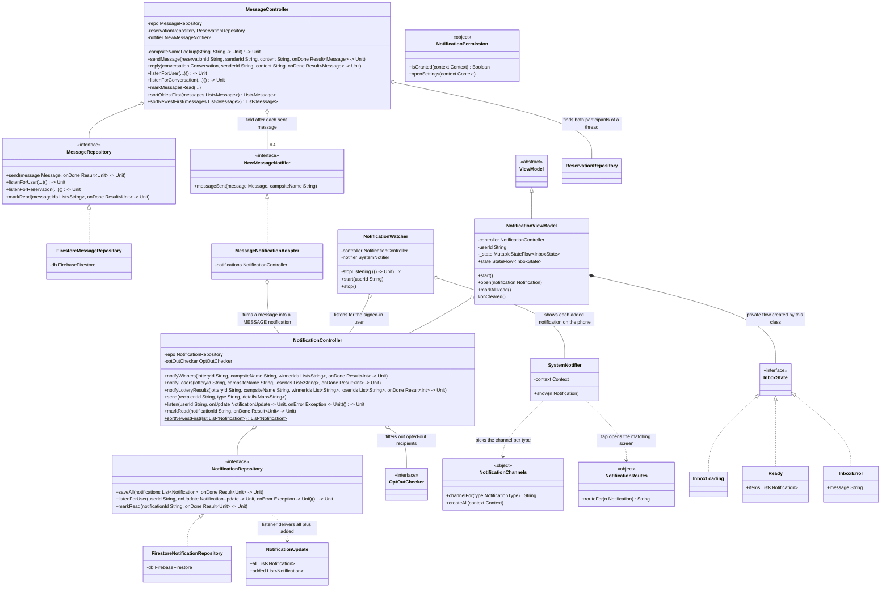
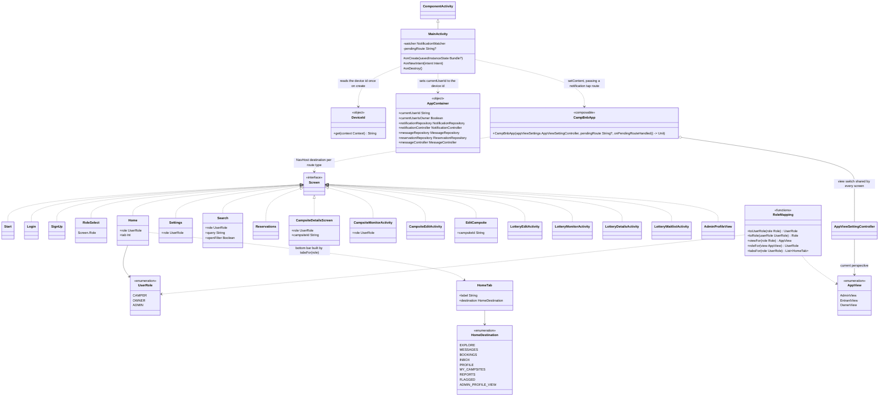

# Application

UML documentation for the CampBNB application
(`CampBNB/app/src/main/java/com/example/campbnb/`),
covering its architecture, domain entities, observable
models, controllers, repositories, notifications,
messaging and navigation.

The database layer is documented separately in Engines,
FirestoreViews and Transactions.

## Layers

Reading the diagram:

- The namespaces represent the source packages. The app
  follows MVC, with controllers handling business rules,
  models holding state, and the UI displaying data.
- Repositories access Firestore through the database layer.
- Aggregation (o--) represents shared collaborators passed
  into controllers.
- Composition (*--) represents the NotificationWatcher
  owned by MainActivity.
- ComposeScreens represents the Compose screen functions.
- AppContainer provides shared application instances.

## Domain entities

The Firestore schemas in `models/`, every one an `Identifiable` subclass registered with
`Database`, plus the plain value classes and enums they use.

Reading the diagram:

- Stored Firestore entities extend Identifiable.
- Deterministic IDs prevent duplicate entries, ratings,
  reservations and booked nights.
- Associations represent references between documents
  through ID fields.
- Directed associations represent enum-typed fields.
- LotteryStatus is derived from timestamps rather than stored.
- Dates use ISO yyyy-MM-dd strings, while lottery windows
  use epoch milliseconds.
- SearchFilters and Conversation are not stored in Firestore.

## Lottery and reservation lifecycles

Reading the diagram:

- Lottery.statusAt(now) determines the current lottery
  status from its timestamps.
- Entrants can join or leave the waitlist while registration
  is OPEN.
- The scheduled function draws winners after registration
  closes (see AutomaticDraws).
- Cancelling or rejecting a reservation releases its
  booked dates. Cancellation also records the refund.

## Observable models

The hand-rolled observer pattern in `models/` and the Compose bridge in
`ui/shared/ObserveModel.kt`.

Reading the diagram:

- UserModel, CampsiteModel and LotteryModel extend
  ObservableModel.
- UserModel and CampsiteModel notify registered observers
  when their state changes.
- LotteryModel uses Compose mutableStateOf instead.
- observeModel connects the observer pattern to Compose
  and removes its observer when the screen leaves composition.
- Aggregation represents entities held by models that
  exist independently in Firestore.## Controllers and repositories

The business rules in `controller/` and the storage rules in `data/`.

```mermaid
classDiagram
    class UserController {
        -model UserModel
        -repo UserRepository
        +identify(deviceId String, onFound User -> Unit, onNotFound () -> Unit, onError String -> Unit)
        +register(deviceId String, name String, email String, phone String, onDone Boolean -> Unit)
        +chooseRole(role Role, onDone Boolean -> Unit)
        +updateProfile(name String, email String, phone String, onDone Boolean -> Unit)
        +setNotificationsEnabled(enabled Boolean, onDone Boolean -> Unit)
        +deleteProfile(onDone Boolean -> Unit)
        +loadAllUsers()
        +filterAllowed(userIds List~String~, onResult List~String~ -> Unit)
        +validateProfile(name String, email String) String?
    }
    class OptOutChecker {
        <<interface>>
        +filterAllowed(userIds List~String~, onResult List~String~ -> Unit)
        +AllowAll$ OptOutChecker
    }
    class CampsiteController {
        -model CampsiteModel
        -repo CampsiteRepository
        +loadAll()
        +loadRatings()
        +search(query String, filters SearchFilters)
        +search(query String, guests Int?)
        +loadAndSearch(query String, filters SearchFilters)
        +selectCampsite(campsiteId String)
        +saveRating(campsiteId String, userId String, stars Int)
        +registerCampsite(...)
        +updateCampsite(...)
        +loadAndSelect(campsiteId String)
        +loadOwnerCampsites(ownerId String)
    }
    class LotteryController {
        -model LotteryModel
        -repo LotteryRepository
        -lotteries QueryEngine~Lottery~
        -clock () -> Long
        +checkIfWon(...)
        +isBookingOpen(...)
        +loadEntrantStatus(campsiteId String, userId String)
        +findOpenLottery(allLotteries List~Lottery~, campsiteId String) Lottery?
        +join(lottery Lottery, userId String)
        +leave(lottery Lottery, userId String)
        +toggleEntrantMembership(userId String)
        +saveLottery(lottery Lottery, onSuccess () -> Unit, onFailure Exception -> Unit)
        +loadOwnerCampsites(ownerId String, onResult List~Campsite~ -> Unit)
        +loadOwnerLotteries(ownerId String)
        +loadWaitlistEntries(lotteryId String, onResult List~WaitingListEntry~ -> Unit)
    }
    class ReservationController {
        -lotteryController LotteryController
        -availability Availability
        -reservations ReservationRepository
        -notifications NotificationController
        -policiesConfirmed MutableSet~String~
        +getAvailableDates(lotteryEntryId String, entrantId String, campsiteId String, onSuccess Set~String~ -> Unit, onFailure Exception -> Unit)
        +confirmPolicies(lotteryEntryId String)
        +createReservation(lotteryEntryId String, entrantId String, ownerId String, campsiteId String, dates Set~String~, ...)
        +cancelReservation(reservationId String, requesterId String, onSuccess () -> Unit, onFailure Exception -> Unit)
        +rejectReservation(reservationId String, requesterId String, onSuccess () -> Unit, onFailure Exception -> Unit)
        +listReservations(...)
        +sendNotification(recipientId String, type String, reservation ReservationModel)
        +generateReceiptCsv(reservation ReservationModel) String
    }
    class ReservationFilter {
        <<enumeration>>
        ACTIVE
        PAST
        CANCELLED
    }
    class Availability {
        -campsites QueryEngine~Campsite~
        +getOpenDates(campsiteId String, onSuccess Set~String~ -> Unit, onFailure Exception -> Unit)
    }

    class UserRepository {
        +findByDeviceId(deviceId String, onSuccess User? -> Unit, onFailure Exception -> Unit)
        +save(user User, onComplete Result~Exception?~ -> Unit)
        +delete(userId String, onComplete Result~Exception?~ -> Unit)
        +getAll(onSuccess List~User~ -> Unit, onFailure Exception -> Unit)
        +getOptedOut(onSuccess List~User~ -> Unit, onFailure Exception -> Unit)
    }
    class CampsiteRepository {
        +SaveCampsite(campsite Campsite, onComplete Result~Exception?~ -> Unit)
        +deleteCampsite(...)
        +getAll(onSuccess List~Campsite~ -> Unit, onFailure Exception -> Unit)
        +getByOwner(ownerId String, onSuccess List~Campsite~ -> Unit, onFailure Exception -> Unit)
        +getAllRatings(onSuccess List~Rating~ -> Unit, onFailure Exception -> Unit)
        +saveRating(rating Rating, onComplete Result~Exception?~ -> Unit)
    }
    class LotteryRepository {
        +loadCampsitesByOwner(...)
        +save(lottery Lottery, onSuccess () -> Unit, onFailure Exception -> Unit)
        +getAllLotteries(onSuccess List~Lottery~ -> Unit, onFailure Exception -> Unit)
        +getLotteriesForOwner(ownerId String, ...)
        +getEntries(...)
        +addEntry(entry WaitingListEntry, onComplete Result~Exception?~ -> Unit)
        +removeEntry(...)
    }
    class ReservationRepository {
        -engine QueryEngine~ReservationModel~
        -reservationWriter WriteEngine~ReservationModel~
        -bookedDateWriter WriteEngine~BookedDate~
        +getActive(...)
        +getPast(...)
        +getCancelled(...)
        +getForOwner(...)
        +getForEntrant(...)
        +getByLotteryEntry(...)
        +getBookedDates(campsiteId String, ...)
        +CheckIfReserved(lotteryEntryId String, ...)
        +save(reservation ReservationModel, onSuccess () -> Unit, onFailure Exception -> Unit)
        +markCancelled(reservationId String, onSuccess () -> Unit, onFailure Exception -> Unit)
        +markRejected(reservationId String, onSuccess () -> Unit, onFailure Exception -> Unit)
    }
    class Database {
        <<object>>
        +Users
        +Campsites
        +Ratings
        +Lotteries
        +WaitingListEntries
        +Reservations
        +BookedDates
        +Notifications
        +Messages
        +transactionEngine() TransactionEngine
    }
    class UserModel
    class CampsiteModel
    class LotteryModel
    class NotificationController

    OptOutChecker <|.. UserController
    UserController o-- UserModel
    UserController o-- UserRepository
    CampsiteController o-- CampsiteModel
    CampsiteController o-- CampsiteRepository
    LotteryController o-- LotteryModel
    LotteryController o-- LotteryRepository
    ReservationController o-- LotteryController : checks the entrant won before booking
    ReservationController o-- Availability : open dates of the campsite
    ReservationController o-- ReservationRepository
    ReservationController o-- NotificationController : tells the other party
    ReservationController ..> ReservationFilter : listReservations slices by it
    UserRepository ..> Database : Users
    CampsiteRepository ..> Database : Campsites and Ratings
    LotteryRepository ..> Database : Lotteries, WaitingListEntries, Campsites
    Availability ..> Database : Campsites read engine
    ReservationRepository ..> Database : Reservations and BookedDates engines
```

Reading the diagram:

- Controllers receive their collaborators through their
  constructors.
- LotteryController accepts a clock for testing time-based rules.
- UserController implements OptOutChecker to respect
  notification preferences.
- Repositories access Firestore through database engines.
  ReservationRepository receives its engines directly.
- Callback parameters are shortened where necessary
  for readability.
- ReservationController checks eligibility, policies
  and date availability before saving a reservation.

## Booking a won campsite

Reading the diagram:

- A failed validation calls onFailure and stops the
  reservation process.
- Deterministic BookedDate IDs and Firestore security
  rules prevent two entrants from booking the same night.

## Notifications and messaging

The `notifications/` package, the inbox and message controllers, and their Firestore
repositories.

Reading the diagram:

- Repository interfaces allow Firestore implementations
  to be replaced with fakes during testing.
- MessageNotificationAdapter connects messaging to
  notifications without directly coupling the controllers.
- Notification listeners are stopped when their owning
  screen or activity is destroyed.
- AppContainer provides shared controller instances.
- NotificationViewModel owns its private state flow.
- Notification stores the in-app record, while
  SystemNotifier displays phone notifications.

## Navigation and wiring

The entry point, the typed routes in `Screen.kt`, and the role and view switching that
decides what each user sees.

Reading the diagram:

- Screen is a sealed interface providing typed
  navigation routes.
- Known users navigate to Home, while new users
  complete SignUp and role selection.
- Home displays navigation tabs based on the user's role.
- RoleMapping converts between Role, UserRole and AppView.
- Destination-specific controllers and models are created
  using remember, while shared instances come from AppContainer.
- MainActivity handles notification taps and passes
  the destination to CampBnbApp.

## Placeholders not yet built

These classes exist in the source as empty shells reserved for later stories, so they
carry no members and no relationships yet: `AdminController`, `ImageRepository`,
`Image`, `Location`, `QRCode`, `NotificationModel`, `AdminActivity`, `BookingActivity`,
`PolicyActivity`, `ProfileActivity`, `UserReservationActivity`,
`OwnerReservationActivity`, `CampsiteDetailsActivity` and `CampsiteSearchActivity`.
`Reservation` is an empty shell marked for deletion: `ReservationModel` is the
reservation schema. `Database.YourSchemaPluralized` is the template object showing how
to register a new collection.
