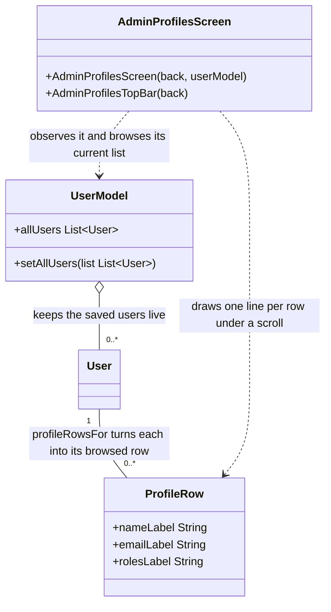

# User Profiles

UML documentation for the admin subview that browses profiles, in
`CampBNB/app/src/main/java/com/example/campbnb/ui/admin/AdminProfilesScreen.kt`
(US 03.05.01). Upstream, the data side already exists: the repository reads every
user and the user model keeps them live for the admin. What is built here is the
listing itself - a subview labelled "Profiles" where every saved profile is drawn
with its name, email address and roles visible (US 03.05.01, as updated on the
issue).

Reading the diagram:

- `ProfileRow` is a plain view data class, not an `Identifiable`: nothing here is
  written to the database, the rows only re-present the saved users.
- `profileRowsFor` is the single pure entry point from users to rows; the
  labels of each field are its private steps, tested through the row.
- The screen binds to the existing `UserModel` through the shared observe helper:
  when the controller loads users, the model notifies, and the listing redraws
  itself; the screen reads the model's current list and never owns it.
- The screen body is a composable pair: the top bar (back affordance plus the
  "Profiles" header) and a scrollable column of row lines. Registration into the
  admin navigation is done separately, same as every other screen body here.

## The listing choices

- Order: display names, case-folded, so capitalization never changes the
  listing; users with no name sort last behind a trailing marker. The request
  does not state an order (PLACEHOLDER note, kept in the code next to the sort
  key).
- Field fallbacks: no name, no email or no role each show a placeholder instead
  of an empty stretch, so a sparse profile still reads as a row.
- Several roles on one person are all shown, slash-separated - the admin
  browsing needs the full capability picture, not one role.
- The row line keeps the three fields in the reading order the request lists:
  name, email, roles.

## Test placement

`AdminProfilesTest.kt` sits at the test root, as the other screen-area suites do.
It drives the model entry points only: nothing browsed, a fields-less user,
order through capital differences with a nameless last, multi-role joining, and
the visible-fields contract of the row line. The screen itself is thin wiring
over tested parts and is not tested separately.
